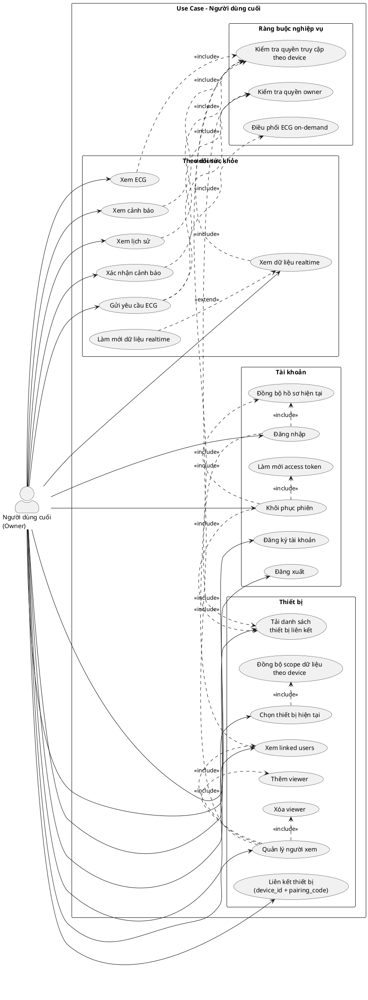
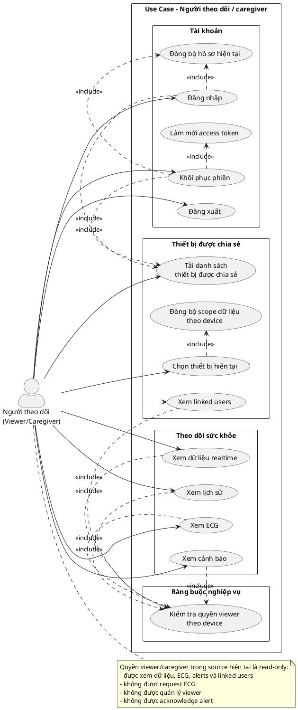
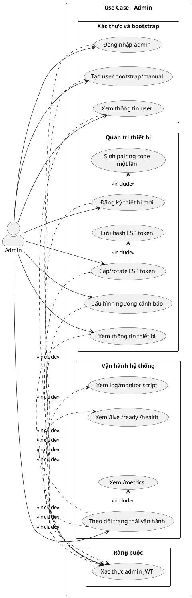
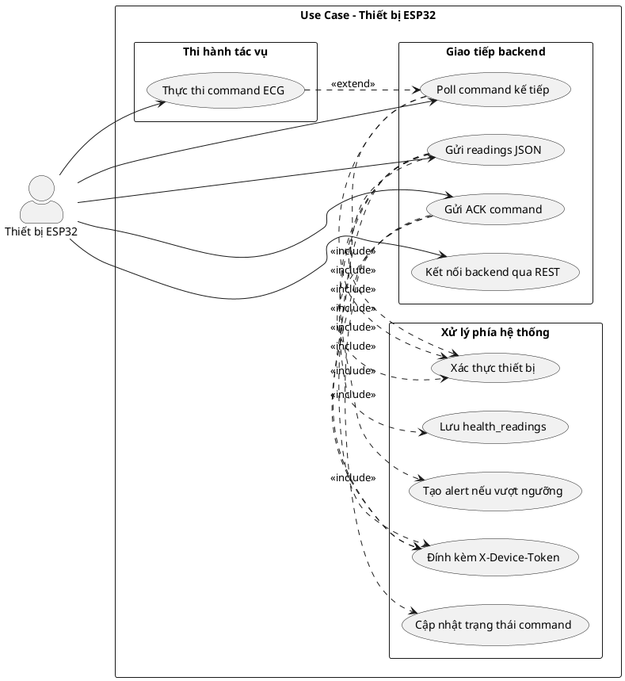
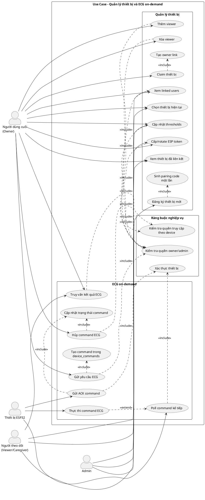

Bộ sơ đồ Use Case chi tiết
Ghi chú ánh xạ actor theo source hiện tại
Hệ thống hiện tại đi theo mô hình device-centric.
Quyền truy cập dữ liệu hằng ngày chủ yếu là `owner` và `viewer`.
Trong bộ sơ đồ này:
`Người dùng cuối` ~= người dùng sở hữu thiết bị (`owner`).
`Người theo dõi/caregiver` ~= người được chia sẻ quyền xem (`viewer`).
`Admin` là quyền hệ thống và bootstrap.
---
1) Sơ đồ Use Case tổng quan hệ thống

```plantuml
@startuml
left to right direction
skinparam shadowing false
skinparam packageStyle rectangle
skinparam actorStyle awesome

actor "Người dùng cuối\n(Owner/Patient)" as EndUser
actor "Người theo dõi\n(Viewer/Caregiver)" as Viewer
actor "Admin" as Admin
actor "Thiết bị ESP32" as ESP

rectangle "Hệ thống theo dõi sức khỏe từ xa" {

  package "Khối người dùng" {
    usecase "Đăng ký tài khoản" as UC_Register
    usecase "Đăng nhập" as UC_Login
    usecase "Khôi phục phiên" as UC_Restore
    usecase "Đăng xuất" as UC_Logout
    usecase "Xem danh sách\nthiết bị liên kết" as UC_MyDevices
    usecase "Liên kết thiết bị\n(pairing code)" as UC_Claim
    usecase "Chọn thiết bị\nđang theo dõi" as UC_SelectDevice
    usecase "Xem dữ liệu realtime" as UC_Latest
    usecase "Xem lịch sử" as UC_History
    usecase "Xem ECG" as UC_ECG
    usecase "Xem cảnh báo" as UC_Alerts
    usecase "Gửi yêu cầu ECG" as UC_RequestECG
    usecase "Quản lý người xem" as UC_Viewers
    usecase "Xác nhận cảnh báo" as UC_AckAlert
  }

  package "Khối quản trị" {
    usecase "Tạo user bootstrap" as UC_CreateUser
    usecase "Đăng ký thiết bị" as UC_RegisterDevice
    usecase "Cấp/rotate ESP token" as UC_RotateToken
    usecase "Cấu hình ngưỡng cảnh báo" as UC_Thresholds
    usecase "Theo dõi health/\nmetrics/logs" as UC_Operations
  }

  package "Khối thiết bị IoT" {
    usecase "Gửi readings sức khỏe" as UC_SendReadings
    usecase "Poll command kế tiếp" as UC_PollCommand
    usecase "Gửi ACK command" as UC_AckCommand
  }

  package "Nghiệp vụ lõi" {
    usecase "Xác thực người dùng" as UC_UserAuth
    usecase "Xác thực thiết bị" as UC_DeviceAuth
    usecase "Kiểm tra quyền theo thiết bị" as UC_Access
    usecase "Lưu dữ liệu sức khỏe" as UC_Store
    usecase "Tạo cảnh báo tự động" as UC_AutoAlert
    usecase "Điều phối ECG on-demand" as UC_OrchECG
  }
}

EndUser --> UC_Register
EndUser --> UC_Login
EndUser --> UC_Restore
EndUser --> UC_Logout
EndUser --> UC_MyDevices
EndUser --> UC_Claim
EndUser --> UC_SelectDevice
EndUser --> UC_Latest
EndUser --> UC_History
EndUser --> UC_ECG
EndUser --> UC_Alerts
EndUser --> UC_RequestECG
EndUser --> UC_Viewers
EndUser --> UC_AckAlert

Viewer --> UC_Login
Viewer --> UC_Restore
Viewer --> UC_Logout
Viewer --> UC_MyDevices
Viewer --> UC_SelectDevice
Viewer --> UC_Latest
Viewer --> UC_History
Viewer --> UC_ECG
Viewer --> UC_Alerts

Admin --> UC_Login
Admin --> UC_CreateUser
Admin --> UC_RegisterDevice
Admin --> UC_RotateToken
Admin --> UC_Thresholds
Admin --> UC_Operations

ESP --> UC_SendReadings
ESP --> UC_PollCommand
ESP --> UC_AckCommand

UC_Login .> UC_UserAuth : <<include>>
UC_Restore .> UC_UserAuth : <<include>>
UC_Latest .> UC_Access : <<include>>
UC_History .> UC_Access : <<include>>
UC_ECG .> UC_Access : <<include>>
UC_Alerts .> UC_Access : <<include>>
UC_RequestECG .> UC_Access : <<include>>
UC_Viewers .> UC_Access : <<include>>
UC_AckAlert .> UC_Access : <<include>>
UC_Thresholds .> UC_Access : <<include>>

UC_SendReadings .> UC_DeviceAuth : <<include>>
UC_SendReadings .> UC_Store : <<include>>
UC_SendReadings .> UC_AutoAlert : <<include>>
UC_PollCommand .> UC_DeviceAuth : <<include>>
UC_PollCommand .> UC_OrchECG : <<include>>
UC_AckCommand .> UC_DeviceAuth : <<include>>
UC_AckCommand .> UC_OrchECG : <<include>>
UC_RequestECG .> UC_OrchECG : <<include>>

@enduml
```

Đặc tả sơ đồ
Mục tiêu: mô tả toàn bộ phạm vi hệ thống theo 4 actor chính: người dùng cuối, người theo dõi, admin và thiết bị ESP32.
Phạm vi: bao trùm nhóm use case người dùng, nhóm quản trị, nhóm thiết bị IoT và các use case nghiệp vụ lõi mà các luồng khác phụ thuộc.
Điểm nhấn: sơ đồ thể hiện hệ thống không chỉ có chiều “đọc dữ liệu”, mà còn có chiều “điều phối tác vụ” thông qua ECG on-demand.
Quan hệ include chính:
mọi luồng đọc dữ liệu đều đi qua `Kiểm tra quyền theo thiết bị`;
luồng thiết bị đều đi qua `Xác thực thiết bị`;
luồng `Gửi readings` luôn kéo theo `Lưu dữ liệu sức khỏe` và `Tạo cảnh báo tự động`.
Tiền điều kiện tổng quát: hệ thống backend hoạt động, MongoDB/Redis sẵn sàng, app và ESP32 truy cập được API.
Hậu điều kiện tổng quát: người dùng truy cập được dữ liệu theo đúng quyền; thiết bị gửi dữ liệu và nhận lệnh; admin quản trị được user/device/token; hệ thống lưu trữ và sinh cảnh báo đúng luồng.
---
2) Sơ đồ Use Case cho người dùng cuối

Đặc tả sơ đồ
Mục tiêu: mô tả đầy đủ các thao tác của người dùng cuối khi người đó là chủ thiết bị (`owner`).
Tác nhân: người dùng ứng dụng Flutter đã đăng ký tài khoản và có ít nhất một thiết bị được liên kết hoặc có thể claim thiết bị mới.
Các nhóm chức năng chính:
tài khoản và phiên: đăng ký, đăng nhập, khôi phục phiên, làm mới token, đăng xuất;
thiết bị: xem danh sách thiết bị, claim thiết bị, chọn thiết bị hiện tại, quản lý viewer;
dữ liệu sức khỏe: xem realtime, history, ECG, alerts và gửi yêu cầu ECG.
Quan hệ include/extend quan trọng:
`Đăng nhập` và `Khôi phục phiên` đều kéo theo `Đồng bộ hồ sơ hiện tại` và `Tải danh sách thiết bị liên kết`;
`Chọn thiết bị hiện tại` kéo theo `Đồng bộ scope dữ liệu theo device`;
`Làm mới dữ liệu realtime` là hành vi mở rộng từ `Xem dữ liệu realtime`;
các tác vụ owner-only như quản lý viewer, xác nhận cảnh báo, gửi yêu cầu ECG đều phải qua `Kiểm tra quyền owner`.
Tiền điều kiện: backend khả dụng; người dùng có tài khoản hợp lệ hoặc có thể tự đăng ký; có thể tồn tại thiết bị chưa claim hoặc đã claim.
Hậu điều kiện: session được thiết lập/khôi phục; device hiện tại được chọn; dữ liệu được tải đúng theo device; viewer/cảnh báo/ECG được thao tác đúng quyền owner.
---
3) Sơ đồ Use Case cho người theo dõi / caregiver

Đặc tả sơ đồ
Mục tiêu: mô tả các use case dành cho người được chia sẻ quyền theo dõi thiết bị.
Tác nhân: viewer/caregiver theo cách gọi của báo cáo; trong source hiện tại actor này tương ứng tốt nhất với quyền `viewer`.
Đặc điểm quyền: tác nhân này chỉ thao tác read-only trên dữ liệu và linked users của thiết bị được chia sẻ.
Quan hệ include chính:
đăng nhập/khôi phục phiên luôn kéo theo đồng bộ user hiện tại và danh sách thiết bị được chia sẻ;
mọi use case đọc dữ liệu đều phải qua `Kiểm tra quyền viewer theo device`;
chọn thiết bị sẽ đồng bộ lại scope của realtime, history, ECG và alerts.
Tiền điều kiện: viewer có tài khoản hợp lệ và đã được owner chia sẻ ít nhất một thiết bị.
Hậu điều kiện: viewer truy cập được dữ liệu đúng thiết bị được chia sẻ nhưng không có quyền thao tác owner-only.
---
4) Sơ đồ Use Case cho admin

Đặc tả sơ đồ
Mục tiêu: mô tả các use case dành cho admin ở mức bootstrap, quản trị thiết bị và vận hành hệ thống.
Tác nhân: admin sử dụng JWT hệ thống hoặc luồng bootstrap được kiểm soát.
Phạm vi chức năng:
tạo user bootstrap/manual;
đăng ký thiết bị mới;
sinh pairing code một lần;
cấp hoặc rotate ESP token;
cấu hình ngưỡng cảnh báo;
theo dõi health, metrics và log vận hành.
Quan hệ include quan trọng:
hầu hết use case admin đều phải qua `Xác thực admin JWT`;
`Đăng ký thiết bị mới` bao gồm `Sinh pairing code một lần`;
`Cấp/rotate ESP token` bao gồm `Lưu hash ESP token`;
`Theo dõi trạng thái vận hành` bao gồm health, metrics và logs.
Tiền điều kiện: admin đã có thông tin xác thực hợp lệ; backend và hạ tầng vận hành đang sẵn sàng.
Hậu điều kiện: user/device/token được tạo hoặc cập nhật đúng; hệ thống có thể được giám sát thông qua health, metrics và logs.
---
5) Sơ đồ Use Case cho thiết bị ESP32

Đặc tả sơ đồ
Mục tiêu: mô tả vai trò của ESP32 như một actor IoT giao tiếp trực tiếp với backend.
Tác nhân: firmware ESP32 đã được cấp `device_id` và `X-Device-Token` hợp lệ.
Các use case cốt lõi:
gửi readings sức khỏe;
poll command kế tiếp;
thực thi command ECG khi có lệnh;
gửi ACK để backend cập nhật vòng đời command.
Quan hệ include/extend quan trọng:
mọi request từ ESP đều phải đính kèm token và đi qua xác thực thiết bị;
`Gửi readings JSON` luôn bao gồm lưu readings và có thể phát sinh alert;
`Thực thi command ECG` là use case mở rộng khi sau `Poll command kế tiếp` backend trả về lệnh ECG.
Tiền điều kiện: thiết bị có kết nối mạng và có token hợp lệ.
Hậu điều kiện: readings được lưu; alert có thể được sinh; trạng thái command được cập nhật sau ACK.
---
6) Sơ đồ Use Case cho nhóm quản lý thiết bị và ECG on-demand

Đặc tả sơ đồ
Mục tiêu: mô tả luồng nghiệp vụ xuyên actor của hai mảng quan trọng nhất: quản lý thiết bị và ECG on-demand.
Tác nhân tham gia:
admin: đăng ký thiết bị, sinh pairing code, hỗ trợ token/threshold;
owner: claim thiết bị, quản lý viewer, cấu hình threshold, request/cancel ECG;
viewer: xem linked users và kết quả ECG theo quyền read-only;
ESP32: poll command, chạy ECG, gửi ACK.
Quan hệ include/extend quan trọng:
`Đăng ký thiết bị mới` bao gồm `Sinh pairing code một lần`;
`Claim thiết bị` bao gồm `Tạo owner link`;
toàn bộ thao tác quản trị thiết bị và ECG của owner/admin đều qua `Kiểm tra quyền owner/admin`;
`Gửi yêu cầu ECG` bao gồm `Tạo command trong device_commands`;
`Thực thi command ECG` là hành vi mở rộng sau `Poll command kế tiếp`;
`Gửi ACK command` và `Hủy command ECG` đều tác động `Cập nhật trạng thái command`.
Tiền điều kiện: admin đã register device hoặc hệ thống đã có device; owner đã đăng nhập; ESP32 online và có token hợp lệ.
Hậu điều kiện: thiết bị được claim/chia sẻ đúng; command ECG được tạo, phát, thực thi và cập nhật trạng thái; app có thể truy vấn kết quả ECG sau khi luồng hoàn tất.
